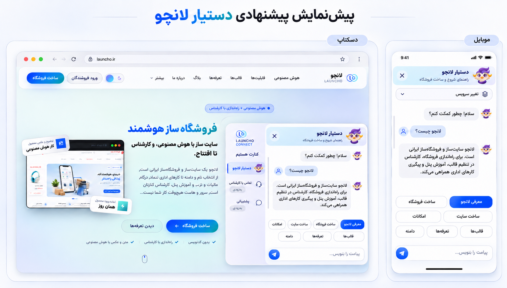
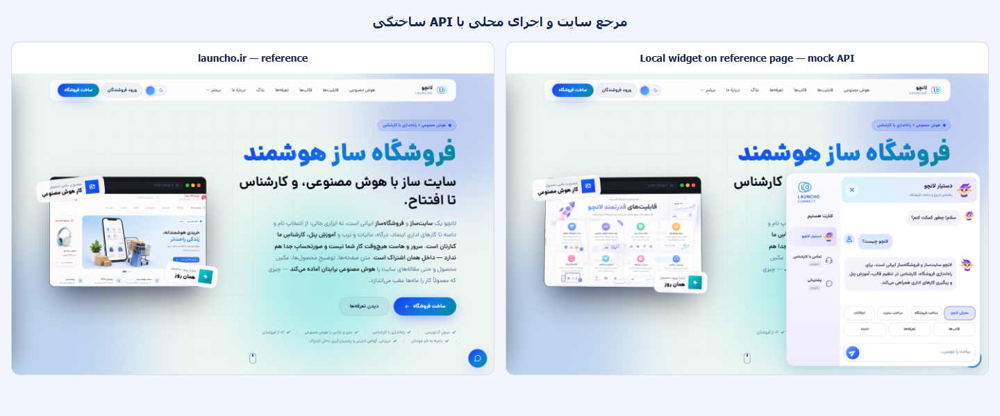
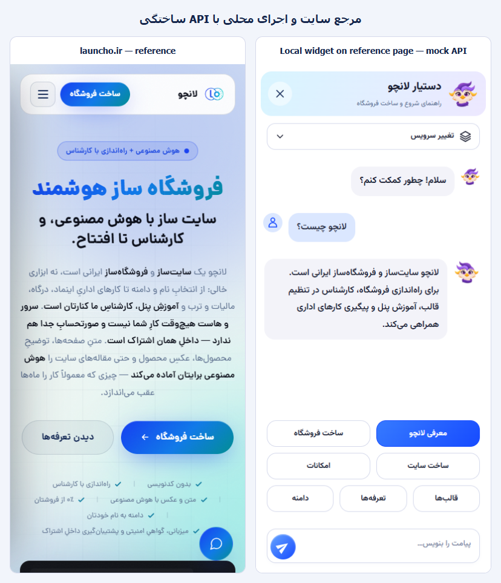

# دستیار جمع‌وجور لانچو

طرح تصویری تأییدشده با حذف دو دکمهٔ بزرگ‌کردن و کوچک‌کردن پیاده شده است. پنجرهٔ عادی دسکتاپ ۵۸۰×۵۸۰ پیکسل است و با حاشیهٔ ۲۴ پیکسل در گوشهٔ صفحه قرار می‌گیرد. سایدبار ۱۶۰ پیکسل عرض دارد؛ در موبایل، انتخاب سرویس در نوار زیر هدر و یک پنجرهٔ انتخاب نمایش داده می‌شود. بزرگ‌کردن پنجره در رابط جدید وجود ندارد؛ این رفتار مطابق آخرین اصلاح تأییدشده است.



## نتیجهٔ مرورگر

تصاویر از اجرای واقعی Chrome با API ساختگی ثبت شده‌اند. نسخهٔ محلی ویجت فقط هنگام عکاسی به صفحهٔ واقعی `https://launcho.ir` تزریق شد؛ سایت منتشرشده تغییری نکرده است. درخواست‌های جلسه و گفتگو در مرورگر رهگیری و پاسخ داده شدند. هیچ درخواست واقعی AI، ساخت فروشگاه یا ثبت دامنه انجام نشد. پیام معرفی از `content/launcho-public.json` خوانده می‌شود.

| نما | viewport | DPR | zoom |
| --- | --- | --- | --- |
| دسکتاپ | 1440×900 | 1 | 100% |
| موبایل | 390×844 | 1 | 100% |

تصاویر اصلی بدون تغییر اندازه در پوشهٔ evidence قرار دارند؛ فقط تصاویر مقایسه‌ای برای قرارگرفتن کنار هم کوچک شده‌اند. صفحهٔ مرجع اسلایدر متحرک دارد و محتوای آن ممکن است بین دو عکس عوض شود. حباب چت موجود سایت مرجع متعلق به سایت است؛ نسخهٔ محلی جایگزین نصب واقعی آن نشده است.





| خروجی | دسکتاپ | موبایل |
| --- | --- | --- |
| صفحهٔ مرجع | [تصویر اصلی](evidence/reference-desktop.png) | [تصویر اصلی](evidence/reference-mobile.png) |
| اجرای محلی روی مرجع | [تصویر اصلی](evidence/implementation-desktop.png) | [تصویر اصلی](evidence/implementation-mobile.png) |
| فقط ویجت | [تصویر اصلی](evidence/widget-desktop.png) | [تصویر اصلی](evidence/widget-mobile.png) |

طرح مرجع یک تصویر تولیدشده است، نه فایل طراحی با مختصات و فونت مشخص. بنابراین تطابق صفر پیکسل با آن ادعا نمی‌شود. اندازهٔ پنجره، سایدبار، کنترل‌ها، ترتیب سؤال‌ها، رنگ‌ها، حباب‌ها و ورودی با طرح بازسازی شده‌اند و هندسهٔ واقعی مرورگر در [گزارش](evidence/report.json) ثبت شده است. قاب مرورگر و تلفن در تصویر طرح بخشی از رابط محصول نیستند.

## رفتار و منابع متن

- معرفی لانچو، ساخت فروشگاه، ساخت سایت، امکانات، قالب‌ها، تعرفه‌ها و دامنه با یک کلیک پیام می‌فرستند. سؤال‌های اطلاعاتی جدید پاسخ را از محتوای بازبینی‌شدهٔ پروژه می‌گیرند؛ مسیرهای قبلی امکانات، شروع فروشگاه و تعرفه حفظ شده‌اند.
- هیچ سؤال آماده‌ای مسیر review یا confirm را خودکار اجرا نمی‌کند. پاسخ مدل و حتی متادیتای ساختگی شامل `confirmed` و `confirmationToken` مجوز ساخت نیستند. تأیید همچنان فقط با کلیک روی دکمهٔ اختصاصی پس از مرور اطلاعات انجام می‌شود.
- قفل درخواست در حال اجرا، فاصلهٔ ۶۵۰ میلی‌ثانیه‌ای مشترک سؤال‌ها و نادیده‌گرفتن کلیک دوم دوبارکلیک مانع ارسال تکراری می‌شوند؛ خطا فقط با انتخاب «تلاش مجدد» و همان شناسهٔ درخواست تکرار می‌شود.
- پیام‌ها مستقل از سایدبار و ورودی اسکرول می‌شوند. هر هفت سؤال در دسترس‌اند. بستن و بازکردن و تغییر سرویس تاریخچه را حفظ می‌کند.
- متن معرفی و اطلاعات سایت، قالب و دامنه از `content/launcho-public.json` گرفته می‌شوند. اطلاعات دامنهٔ زنده و جزئیات اتصال به پشتیبانی رسمی ارجاع داده می‌شود. تعرفه از مسیر موجود و منابع رسمی می‌آید و عدد تازه‌ای در رابط نوشته نشده است.

## اجرای آزمون‌ها

```powershell
python -m pip install -r requirements-dev.txt
python -m unittest discover -s tests -v
node --experimental-vm-modules --test tests/widget_session_test.cjs
python tests/check_demo.py --backend-only --check-core
python tests/widget_compact_browser.py --reference
```

آزمون مرورگر به Chrome نصب‌شده نیاز دارد. حالت بدون `--reference` کاملاً محلی است. حالت مرجع فقط صفحهٔ عمومی سایت را برای عکاسی می‌خواند و تمام APIهای ویجت را ساختگی پاسخ می‌دهد. خروجی تازه در `artifacts/widget-compact/` نوشته می‌شود.

۱۳ سناریوی مرورگر پاس شده‌اند: ۸ اندازهٔ صفحه، ارسال تک‌کلیکی هفت سؤال با متادیتای نامعتبر، کلیک سریع با پاسخ کند و فوری، خطا و retry صریح، و دو مقایسه با سایت مرجع. هر اندازه در تم روشن و تیره، با متن بلند، اسکرول و بستن و بازکردن بررسی شده است. انتخاب سرویس موبایل و بازگشت فوکوس نیز بررسی شده‌اند. [موبایل باریک](evidence/mobile-small.png)، [ارتفاع شبیه صفحه‌کلید](evidence/keyboard-height.png) و [حالت افقی](evidence/landscape.png) نیز ثبت شده‌اند. آزمون صفحه‌کلید با کم‌کردن viewport انجام شده و جای آزمون روی دستگاه فیزیکی را نمی‌گیرد.

هر ۱۹۷ آزمون Python پس از همگام‌سازی شاخه با آخرین `main` پاس شده‌اند. آزمون جلسهٔ Node و بررسی محلی بک‌اند، مالکیت جلسه، مرور و تأیید صریح، تکرار هم‌زمان درخواست و مسیرهای سایت و فروشگاه نیز پاس شده‌اند. بررسی نحو سه فایل JavaScript تغییرکرده و `git diff --check` نیز موفق بوده است. [خروجی آزمون‌های Python](evidence/unit-tests.txt) همراه تغییرات ذخیره شده است.
